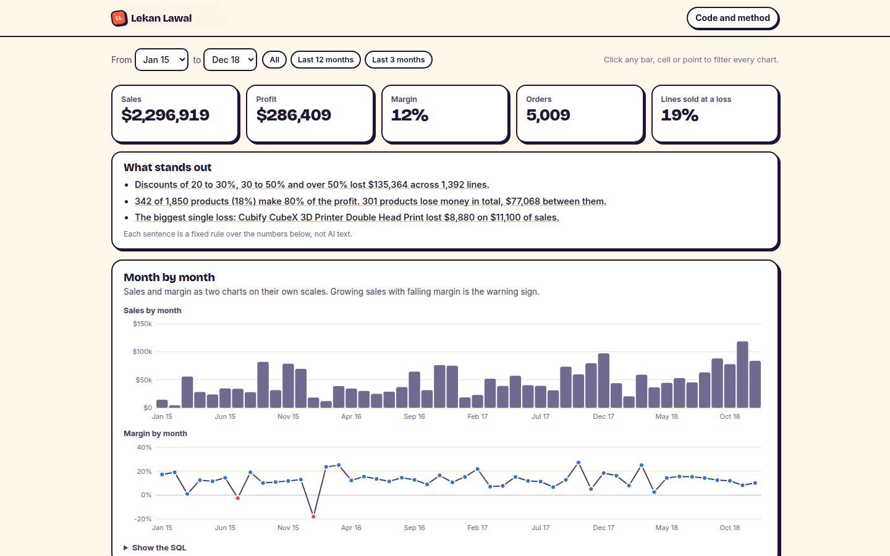

# Money Snitch

Tells a small business who's taking its money. Drop in a sales export to see where your profit goes, or a card processing statement to see what you really pay to take cards. Everything runs in your browser, so no file is ever uploaded.

[Try it](https://lekanlawal1.github.io/project1-bi-dashboard/) · [Go straight to card fees](https://lekanlawal1.github.io/project1-bi-dashboard/#fees)



## Why I built it

It started as a standard dashboard of a sample dataset. That's fine for a portfolio, but useless to an actual business owner. The person I had in mind has sales going up and a bank balance that isn't, and they can't tell why. So I turned it into something they can point at their own files.

## Profit margins

You drop in an export from Shopify, Square, QuickBooks or a spreadsheet, confirm which column is which, and get a dashboard. It shows where discounting starts losing money, which products lose it, and how margin moves month by month. Click anything and every chart filters to it. Under each chart you can open the exact SQL it ran.

Real exports are messy, so the hard part was reading them. Totals rows, notes and duplicate lines are skipped and counted, not silently included. Dates in either day or month order are worked out from the values. One test file caught a nasty bug: DuckDB guessed that `#` starts a comment, and Shopify names every order `#1001`, so an entire export would have vanished.

## Card fees

Card statements mix three kinds of fees under labels that don't tell you who gets the money: the bank that issued the card, the card network, and your processor. Only the processor's share is negotiable. The checker reads the statement PDF, sorts every dollar into one of those three, checks the fees against published card-network rates, and flags overcharges, downgrades and fee lines with wrong arithmetic.

It refuses to show anything until the statement adds up to the cent. For layouts it doesn't know, it looks for the combination of sections that adds up exactly to the printed fee total, and gives up if there's none or more than one. A wrong reading would have to hit the exact total by accident.

I tested it on two real statements, one US and one Canadian, read locally and never committed. Every check passed on both, and every interchange line I could check matched the published rate.

## Limits

Scanned statements have no text to read. US Mastercard rates come from a secondary source, and Canadian Mastercard rates aren't checked yet. It's a check, not financial advice.

## Run it

```bash
node --test tests/core.test.mjs tests/fees.test.mjs
python -m pytest tests -q          # checks the dashboard's SQL against pandas
python3 -m http.server 8800        # http://localhost:8800
```

## More

[docs/details.md](docs/details.md) has the full write-up: every check the statement reader runs, how the general reader works, and how it was tested. The original fixed dashboard is still at [/dashboard/](https://lekanlawal1.github.io/project1-bi-dashboard/dashboard/), with its [business case](docs/business_case.md).
